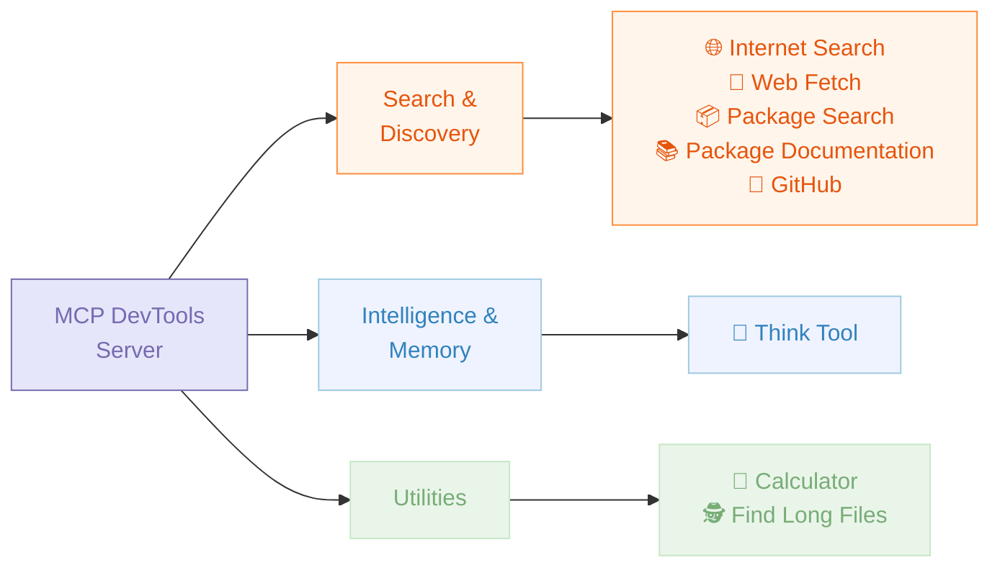
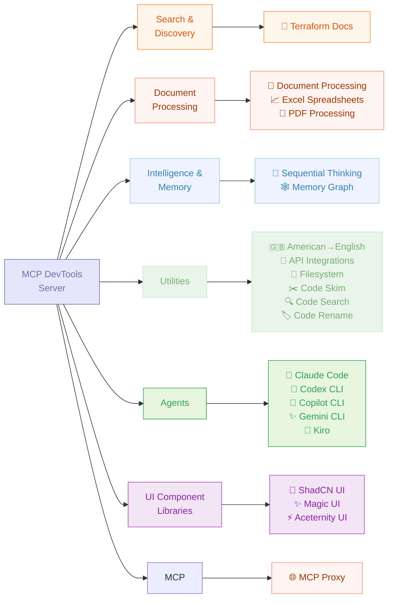

# MCP DevTools

A single, high-performance MCP server that replaces many Node.js and Python-based MCP servers with one efficient Go binary, providing access to essential developer tools through a unified, modular interface that can be easily extended with new tools.

**Default Tools**



**Additional Tools (Disabled by Default)**



## Why I Built MCP DevTools

**🚀 Single Binary Solution**

- Replace multiple potentially resource-heavy Node.js/Python MCP servers, each spawned for every client tool you use
- One binary, one configuration, consistent performance
- Built in Go for speed and efficiency and because I'm not smart enough to write Rust
- Minimal memory footprint compared to multiple separate servers
- Fast startup and response times
- Download one binary, configure once - or compile from source
- Works out of the box for most tools
- OpenTelemetry support for tracing and metrics

**🛠 Comprehensive Tool Suite For Agentic Coding**

- 20+ essential developer agent tools in one package
- No need to manage multiple MCP server installations
- Consistent API across all tools
- Modular design with tool registry allowing for easy addition of new tools

## Quickstart

### Quick Install / Update

If you have Golang installed, simply run `go install github.com/sammcj/mcp-devtools@HEAD` and it will be installed to your $GOPATH/bin.

There is also an experimental installer script:

```bash
curl -fsSL https://raw.githubusercontent.com/sammcj/mcp-devtools/main/install.sh | bash
```

This will:

- Download the latest release and installs to an appropriate location (respects `$GOPATH/bin` or uses `~/.local/bin`)
- Remove macOS quarantine attributes automatically
- Generate example MCP client configurations in `~/.mcp-devtools/examples/`
- Open your file manager to show the example configs and show you where to configure your MCP clients

<details>
  <summary><b>🔗 Quick Install Customisation (Click Here)</b></summary>

**Customisation:**

```bash
# Dry run (shows what would be done without making changes)
DRY_RUN=1 curl -fsSL https://raw.githubusercontent.com/sammcj/mcp-devtools/main/install.sh | bash

# Install to a specific directory
INSTALL_DIR=/custom/path curl -fsSL https://raw.githubusercontent.com/sammcj/mcp-devtools/main/install.sh | bash

# Install a specific version
VERSION=0.50.0 curl -fsSL https://raw.githubusercontent.com/sammcj/mcp-devtools/main/install.sh | bash

# Skip example config generation
NO_CONFIG=1 curl -fsSL https://raw.githubusercontent.com/sammcj/mcp-devtools/main/install.sh | bash

# Skip all confirmation prompts (for automation)
FORCE=1 curl -fsSL https://raw.githubusercontent.com/sammcj/mcp-devtools/main/install.sh | bash
```

</details>

### Manual Installation

<details>
  <summary><b>🔗 Manual Installation (Click Here)</b></summary>

You have a few other options to make MCP DevTools available to your MCP clients:

1.  If you have Golang installed
2. [If you do not have, and do not want to install Golang](#if-you-do-not-have-golang-installed)

### If you have Golang installed

#### Golang option 1: Use the automated installer

The automated installer works great even if you have Golang installed:

```bash
curl -fsSL https://raw.githubusercontent.com/sammcj/mcp-devtools/main/install.sh | bash
```

This will respect your `$GOPATH/bin` if it's in your PATH, and automatically configure example MCP client settings.

#### Golang option 2: Download at runtime

Note that while `go run` makes it easy to get started, it means every time your client starts to download the tool may not be what you want in the long run.

MCP Client Configuration:

```json
{
  "mcpServers": {
    "dev-tools": {
      "type": "stdio",
      "command": "go",
      "args": ["run", "github.com/sammcj/mcp-devtools@HEAD"],
      "env": {
        "ENABLE_ADDITIONAL_TOOLS": "security,sequential_thinking,code_skim,code_rename",
        "DISABLED_TOOLS": "",
        "NOTE_FOR_HUMANS": "A minimal set of tools are enabled by default, MCP DevTools provides many additional useful tools including efficient Context7 documentation search, Frontend UI Framework templates, Code search and optimisation and many others, visit https://github.com/sammcj/mcp-devtools for more information on available tools and configuration"
      }
    }
  }
}
```

Or if you're using Claude Code you can also add it via the CLI:

```bash
claude mcp add --transport stdio mcp-devtools go run github.com/sammcj/mcp-devtools@HEAD
```

- [](https://lmstudio.ai/install-mcp?name=dev-tools&config=eyJjb21tYW5kIjoiZ28iLCJhcmdzIjpbInJ1biIsImh0dHBzOi8vZ2l0aHViLmNvbS9zYW1tY2ovbWNwLWRldnRvb2xzQEhFQUQiXSwiZW52Ijp7IkVOQUJMRV9BRERJVElPTkFMX1RPT0xTIjoic2VjdXJpdHksc2VxdWVudGlhbF90aGlua2luZyxnaXRodWIsZ2V0X3Rvb2xfaGVscCIsIkRJU0FCTEVEX1RPT0xTIjoic2VhcmNoX3BhY2thZ2VzLHJlc29sdmVfbGlicmFyeV9pZCxnZXRfbGlicmFyeV9kb2N1bWVudGF0aW9uIiwiTk9URV9GT1JfSFVNQU5TIjoiQSBtaW5pbWFsIHNldCBvZiB0b29scyBhcmUgZW5hYmxlZCBieSBkZWZhdWx0LCBNQ1AgRGV2VG9vbHMgcHJvdmlkZXMgbWFueSBhZGRpdGlvbmFsIHVzZWZ1bCB0b29scyBpbmNsdWRpbmcgZWZmaWNpZW50IENvbnRleHQ3IGRvY3VtZW50YXRpb24gc2VhcmNoLCBGcm9udGVuZCBVSSBGcmFtZXdvcmsgdGVtcGxhdGVzLCBDb2RlIHNlYXJjaCBhbmQgb3B0aW1pc2F0aW9uIGFuZCBtYW55IG90aGVycywgdmlzaXQgaHR0cHM6Ly9naXRodWIuY29tL3NhbW1jai9tY3AtZGV2dG9vbHMgZm9yIG1vcmUgaW5mb3JtYXRpb24gb24gYXZhaWxhYmxlIHRvb2xzIGFuZCBjb25maWd1cmF0aW9uIn19)
- [](vscode:mcp/install?%7B%22name%22%3A%22dev-tools%22%2C%22type%22%3A%22stdio%22%2C%22command%22%3A%22go%22%2C%22args%22%3A%5B%22run%22%2C%22https%3A%2F%2Fgithub.com%2Fsammcj%2Fmcp-devtools%40HEAD%22%5D%2C%22env%22%3A%7B%22ENABLE_ADDITIONAL_TOOLS%22%3A%22security%2Csequential_thinking%2Ccode_skim%2Ccode_rename%22%2C%22DISABLED_TOOLS%22%3A%22search_packages%2Cresolve_library_id%2Cget_library_documentation%22%2C%22NOTE_FOR_HUMANS%22%3A%22A%20minimal%20set%20of%20tools%20are%20enabled%20by%20default%2C%20MCP%20DevTools%20provides%20many%20additional%20useful%20tools%20including%20efficient%20Context7%20documentation%20search%2C%20Frontend%20UI%20Framework%20templates%2C%20Code%20search%20and%20optimisation%20and%20many%20others%2C%20visit%20https%3A%2F%2Fgithub.com%2Fsammcj%2Fmcp-devtools%20for%20more%20information%20on%20available%20tools%20and%20configuration%22%7D%7D)

#### Golang option 3: Download, then run

<details>
  <summary><b>🔗 Click here for instructions</b></summary>

1. Install the latest MCP DevTools binary:

```shell
go install github.com/sammcj/mcp-devtools@HEAD
echo "${GOPATH}/bin/mcp-devtools" # Use this path in your MCP configuration, if your GOPATH is not set, please check your Go installation / configuration.

# If you're on macOS, you'll also need to run the following command to allow the downloaded binary to run:
xattr -r -d com.apple.quarantine ${GOPATH}/bin/mcp-devtools
```

1. Update your MCP client to add the MCP DevTools server configuration, replacing `/path/to/mcp-devtools` with the actual path to the binary (e.g. `/Users/samm/go/bin/mcp-devtools`):

```json
{
  "mcpServers": {
    "dev-tools": {
      "type": "stdio",
      "command": "/path/to/mcp-devtools",
      "env": {
        "ENABLE_ADDITIONAL_TOOLS": "security,sequential_thinking,code_skim,code_rename",
        "DISABLED_TOOLS": "",
        "NOTE_FOR_HUMANS": "A minimal set of tools are enabled by default, MCP DevTools provides many additional useful tools including efficient Context7 documentation search, Frontend UI Framework templates, Code search and optimisation and many others, visit https://github.com/sammcj/mcp-devtools for more information on available tools and configuration"
      }
    }
  }
}
```

- [](https://lmstudio.ai/install-mcp?name=dev-tools&config=eyJjb21tYW5kIjoiL3BhdGgvdG8vbWNwLWRldnRvb2xzIiwiZW52Ijp7IkVOQUJMRV9BRERJVElPTkFMX1RPT0xTIjoic2VjdXJpdHksc2VxdWVudGlhbF90aGlua2luZyxnaXRodWIsZ2V0X3Rvb2xfaGVscCIsIkRJU0FCTEVEX1RPT0xTIjoic2VhcmNoX3BhY2thZ2VzLHJlc29sdmVfbGlicmFyeV9pZCxnZXRfbGlicmFyeV9kb2N1bWVudGF0aW9uIiwiTk9URV9GT1JfSFVNQU5TIjoiQSBtaW5pbWFsIHNldCBvZiB0b29scyBhcmUgZW5hYmxlZCBieSBkZWZhdWx0LCBNQ1AgRGV2VG9vbHMgcHJvdmlkZXMgbWFueSBhZGRpdGlvbmFsIHVzZWZ1bCB0b29scyBpbmNsdWRpbmcgZWZmaWNpZW50IENvbnRleHQ3IGRvY3VtZW50YXRpb24gc2VhcmNoLCBGcm9udGVuZCBVSSBGcmFtZXdvcmsgdGVtcGxhdGVzLCBDb2RlIHNlYXJjaCBhbmQgb3B0aW1pc2F0aW9uIGFuZCBtYW55IG90aGVycywgdmlzaXQgaHR0cHM6Ly9naXRodWIuY29tL3NhbW1jai9tY3AtZGV2dG9vbHMgZm9yIG1vcmUgaW5mb3JtYXRpb24gb24gYXZhaWxhYmxlIHRvb2xzIGFuZCBjb25maWd1cmF0aW9uIn19)
- [](vscode:mcp/install?%7B%22name%22%3A%22dev-tools%22%2C%22type%22%3A%22stdio%22%2C%22command%22%3A%22%2Fpath%2Fto%2Fmcp-devtools%22%2C%22env%22%3A%7B%22ENABLE_ADDITIONAL_TOOLS%22%3A%22security%2Csequential_thinking%2Ccode_skim%2Ccode_rename%22%2C%22DISABLED_TOOLS%22%3A%22search_packages%2Cresolve_library_id%2Cget_library_documentation%22%2C%22NOTE_FOR_HUMANS%22%3A%22A%20minimal%20set%20of%20tools%20are%20enabled%20by%20default%2C%20MCP%20DevTools%20provides%20many%20additional%20useful%20tools%20including%20efficient%20Context7%20documentation%20search%2C%20Frontend%20UI%20Framework%20templates%2C%20Code%20search%20and%20optimisation%20and%20many%20others%2C%20visit%20https%3A%2F%2Fgithub.com%2Fsammcj%2Fmcp-devtools%20for%20more%20information%20on%20available%20tools%20and%20configuration%22%7D%7D)

</details>

### If you do not have Golang installed

<details>
  <summary><b>🔗 Click here for instructions</b></summary>

If you do not have, and do not want to install Golang, you can download the latest release binary from the [releases page](https://github.com/sammcj/mcp-devtools/releases/latest).

```shell
# If you're on macOS, you'll also need to run the following command to allow the downloaded binary to run:
xattr -r -d com.apple.quarantine mcp-devtools
```

Configure your MCP client to use the downloaded binary (replacing `/path/to/mcp-devtools` ):

```json
{
  "mcpServers": {
    "dev-tools": {
      "type": "stdio",
      "command": "/path/to/mcp-devtools",
      "env": {
        "ENABLE_ADDITIONAL_TOOLS": "security,sequential_thinking,code_skim,code_rename",
        "DISABLED_TOOLS": "",
        "NOTE_FOR_HUMANS": "A minimal set of tools are enabled by default, MCP DevTools provides many additional useful tools including efficient Context7 documentation search, Frontend UI Framework templates, Code search and optimisation and many others, visit https://github.com/sammcj/mcp-devtools for more information on available tools and configuration"
      }
    }
  }
}
```

- [](https://lmstudio.ai/install-mcp?name=dev-tools&config=eyJjb21tYW5kIjoiL3BhdGgvdG8vbWNwLWRldnRvb2xzIiwiZW52Ijp7IkVOQUJMRV9BRERJVElPTkFMX1RPT0xTIjoic2VjdXJpdHksc2VxdWVudGlhbF90aGlua2luZyxnaXRodWIsZ2V0X3Rvb2xfaGVscCIsIkRJU0FCTEVEX1RPT0xTIjoic2VhcmNoX3BhY2thZ2VzLHJlc29sdmVfbGlicmFyeV9pZCxnZXRfbGlicmFyeV9kb2N1bWVudGF0aW9uIiwiTk9URV9GT1JfSFVNQU5TIjoiQSBtaW5pbWFsIHNldCBvZiB0b29scyBhcmUgZW5hYmxlZCBieSBkZWZhdWx0LCBNQ1AgRGV2VG9vbHMgcHJvdmlkZXMgbWFueSBhZGRpdGlvbmFsIHVzZWZ1bCB0b29scyBpbmNsdWRpbmcgZWZmaWNpZW50IENvbnRleHQ3IGRvY3VtZW50YXRpb24gc2VhcmNoLCBGcm9udGVuZCBVSSBGcmFtZXdvcmsgdGVtcGxhdGVzLCBDb2RlIHNlYXJjaCBhbmQgb3B0aW1pc2F0aW9uIGFuZCBtYW55IG90aGVycywgdmlzaXQgaHR0cHM6Ly9naXRodWIuY29tL3NhbW1jai9tY3AtZGV2dG9vbHMgZm9yIG1vcmUgaW5mb3JtYXRpb24gb24gYXZhaWxhYmxlIHRvb2xzIGFuZCBjb25maWd1cmF0aW9uIn19)
- [](vscode:mcp/install?%7B%22name%22%3A%22dev-tools%22%2C%22type%22%3A%22stdio%22%2C%22command%22%3A%22%2Fpath%2Fto%2Fmcp-devtools%22%2C%22env%22%3A%7B%22ENABLE_ADDITIONAL_TOOLS%22%3A%22security%2Csequential_thinking%2Ccode_skim%2Ccode_rename%22%2C%22DISABLED_TOOLS%22%3A%22search_packages%2Cresolve_library_id%2Cget_library_documentation%22%2C%22NOTE_FOR_HUMANS%22%3A%22A%20minimal%20set%20of%20tools%20are%20enabled%20by%20default%2C%20MCP%20DevTools%20provides%20many%20additional%20useful%20tools%20including%20efficient%20Context7%20documentation%20search%2C%20Frontend%20UI%20Framework%20templates%2C%20Code%20search%20and%20optimisation%20and%20many%20others%2C%20visit%20https%3A%2F%2Fgithub.com%2Fsammcj%2Fmcp-devtools%20for%20more%20information%20on%20available%20tools%20and%20configuration%22%7D%7D)

</details>

</details>

---

## Available Tools

These tools can be disabled by adding their function name to the `DISABLED_TOOLS` environment variable in your MCP configuration.

| Tool                                                             | Purpose                               | Dependencies                  | Example Usage                   | Maturity |
| ---------------------------------------------------------------- | ------------------------------------- | ----------------------------- | ------------------------------- | -------- |
| **[Internet Search](docs/tools/internet_search.md)**             | Multi-provider internet search        | None (Provider keys optional) | Web, image, news, video search  | 🟢       |
| **[Web Fetch](docs/tools/web-fetch.md)**                         | Retrieve internet content as Markdown | None                          | Documentation and articles      | 🟢       |
| **[Package Documentation](docs/tools/package-documentation.md)** | Context7 library documentation lookup | None                          | React, modelcontextprotocol/go-sdk | 🟢    |
| **[Package Search](docs/tools/package-search.md)**               | Check package versions                | None                          | NPM, Python, Go, Java, Docker   | 🟢       |
| **[Think](docs/tools/think.md)**                                 | Structured reasoning space            | None                          | Complex problem analysis        | 🟢       |
| **[Calculator](docs/tools/calculator.md)**                       | Basic arithmetic calculations         | None                          | 2 + 3 \* 4, batch processing    | 🟢       |
| **[DevTools Help](docs/tools/get_tool_help.md)**                 | Extended info about DevTools tools    | None                          | Usage examples, troubleshooting | 🟢       |
| **[Find Long Files](docs/tools/find_long_files.md)**             | Identify files needing refactoring    |                               | Find files over 700 lines       | 🟢       |
| **[Sequential Thinking](docs/tools/sequential-thinking.md)**     | Structured multi-step reasoning        | None                          | Step-by-step analysis (stdio only) | 🟢    |

### Additional Tools (Disabled By Default)

These tools can be enabled by setting the `ENABLE_ADDITIONAL_TOOLS` environment variable in your MCP configuration.

| Tool                                                                 | Purpose                                                   | `ENABLE_ADDITIONAL_TOOLS` | Example Usage                                 | Maturity |
| -------------------------------------------------------------------- | --------------------------------------------------------- | ------------------------- | --------------------------------------------- | -------- |
| **[GitHub](docs/tools/github.md)**                                   | GitHub repositories and data                              | `github`                  | Issues, PRs, repos, cloning                   | 🟢       |
| **[Code Skim](docs/tools/code_skim.md)**                             | Return code structure without implementation details      | `code_skim`               | Reduced token consumption                     | 🟢       |
| **[Code Search](docs/tools/code_search.md)**                         | Semantic code search with local embeddings                | `code_search`             | Find code by natural language description     | 🟠       |
| **[Code Rename](docs/tools/code_rename.md)**                         | LSP-based symbol renaming across files (experimental)     | `code_rename`             | Rename functions, variables, types            | 🟠       |
| **[Memory](docs/tools/memory.md)**                                   | Persistent knowledge graphs                               | `memory`                  | Store entities and relationships              | 🟡       |
| **[Document Processing](docs/tools/document-processing.md)**         | Convert documents to Markdown                             | `process_document`        | PDF, DOCX → Markdown with OCR                 | 🟡       |
| **[PDF Processing](docs/tools/pdf-processing.md)**                   | Fast PDF text extraction                                  | `pdf`                     | Quick PDF to Markdown                         | 🟢       |
| **[Excel](docs/tools/excel.md)**                                     | Excel file manipulation                                   | `excel`                   | Workbooks, charts, pivot tables, formulas     | 🟢       |
| **[Terraform Documentation](docs/tools/terraform-documentation.md)** | Terraform Registry API (providers, modules, and policies) | `terraform_documentation` | Provider docs, module search, policy lookup   | 🟡       |
| **[Filesystem](docs/tools/filesystem.md)**                           | File and directory operations                             | `filesystem`              | Read, write, edit, search files               | 🟡       |
| **[MCP Proxy](docs/tools/proxy.md)**                                 | Proxies MCP requests to upstream HTTP MCP se